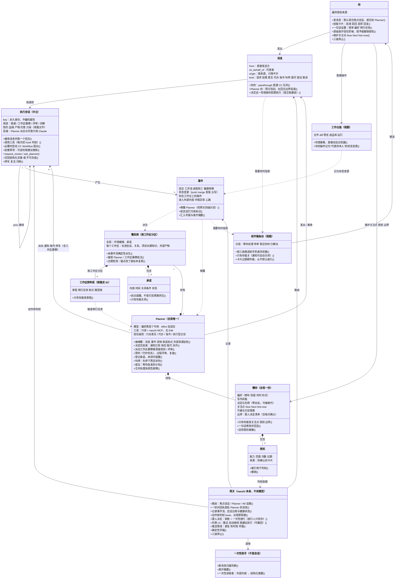
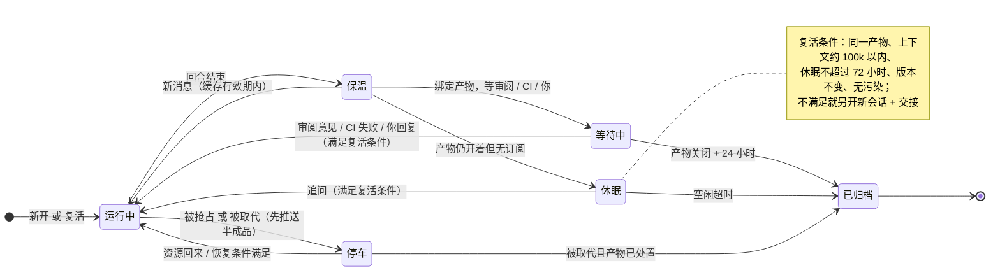
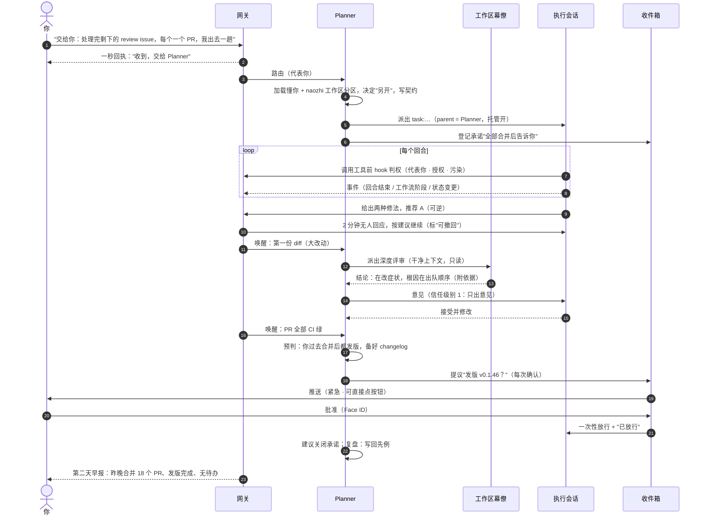

# Planner 对象模型示意图

对应 `docs/rfc/planner.md` v7 §3–§7、§10（决策 D60–D74）。三张图：对象关系与基本行为、执行会话的生命周期、一个典型流程中各对象如何协作。**清晰版请看 `docs/design/planner-object-model.html`**（手工排版的静态 SVG，浏览器直接打开）；下面的 mermaid 是同一内容的源码，GitHub 会自动排版，对象多时布局可能较乱。

v7 相对 v5 的变化：Planner 全局唯一，分层的是知识（懂你一份、懂系统按工作区分区）；工作区幕僚只是执行会话的一种用途；Planner 的介入按信任阶梯由你逐级放开；放行人只有你；新增承诺、早报与工作台面。

## 1. 对象关系与基本行为

- 实线箭头：主动动作（发出、派出、路由、记录）；虚线箭头：派生或依据（由什么得出、按什么判定）。
- 菱形：持有 / 包含（整体与部分）。
- 方框下半部分以 `+` 开头的是该对象的基本行为。

## 2. 执行会话的生命周期

v7 未变。进程、上下文、记录分层回收，寿命跟产物走（RFC §5.2）。

## 3. 典型流程：你交一个大任务后离开

